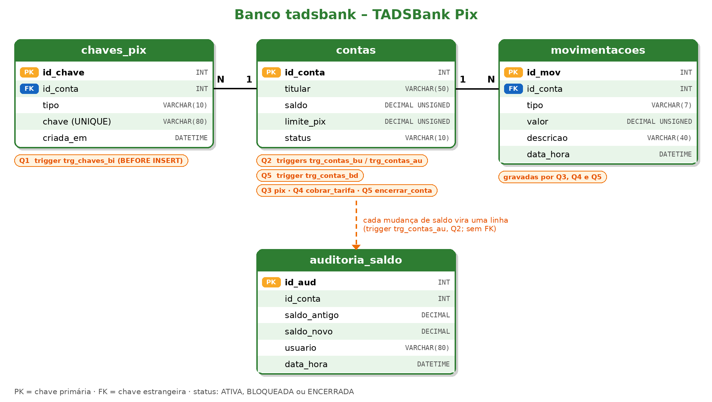

# Atividade 04 – Stored Procedures e Triggers no TADSBank Pix

**IFPI Campus Floriano · TADS – Módulo III · Banco de Dados II · 2026.2**
Prof. Me. Robson Pires Borges

| Duração | Valor | Banco | SGBD |
|---|---|---|---|
| 100 minutos (1 aula dupla) | 10,0 pontos (5 questões) | `tadsbank` | MySQL 5.7 (Docker da disciplina) |

O **TADSBank** vai lançar o **Pix**. Sua equipe precisa colocar as regras do
negócio **dentro do banco de dados**, com *triggers* (regras que disparam
sozinhas) e *stored procedures* (operações completas, com transação).



---

## 1. Como começar

1. Crie o **seu** repositório a partir deste:
   botão verde **Use this template → Create a new repository**.
   (Sem conta no GitHub? Use **Code → Download ZIP**.)
2. Clone o seu repositório no computador do laboratório:
   ```bash
   git clone https://github.com/SEU-USUARIO/SEU-REPOSITORIO.git
   cd SEU-REPOSITORIO
   ```
3. Ligue o ambiente Docker da disciplina:
   ```bash
   cd ~/Apache-PHP8-MySQL && docker compose up -d && cd -
   docker ps          # o container mysql-db precisa aparecer como "Up"
   ```
4. Crie o banco `tadsbank` com os dados iniciais:
   ```bash
   ./resetar.sh       # pede a senha do root do SEU MySQL
   ```
   > **Atenção:** o script **apaga e recria** o banco `tadsbank`.
5. Preencha o arquivo [`ALUNOS.md`](ALUNOS.md) com o nome de quem fez a atividade.

## 2. Estrutura do repositório

```text
.
├── ALUNOS.md                     ← quem fez a atividade
├── sql/
│   ├── 00_tadsbank.sql           ← cria o banco e os dados iniciais (NÃO edite)
│   ├── q1_trigger_chaves_pix.sql ← Questão 1
│   ├── q2_triggers_contas.sql    ← Questão 2
│   ├── q3_procedure_pix.sql      ← Questão 3
│   ├── q4_procedure_tarifa.sql   ← Questão 4
│   └── q5_encerrar_conta.sql     ← Questão 5
├── testes/verificar.sql          ← testes automáticos (NÃO edite)
├── resetar.sh                    ← dados iniciais + os seus objetos
├── verificar.sh                  ← dados iniciais + os seus objetos + testes + nota
└── .github/workflows/            ← roda o verificador no GitHub a cada push
```

Cada arquivo `qN_*.sql` tem o **enunciado completo** no topo, um
**esqueleto** para você completar (`-- TODO`) e, depois da linha

```sql
-- ======================= TESTES =======================
```

os comandos de teste com o **resultado esperado**. O verificador só lê o
que está **acima** dessa linha: não apague a linha.

## 3. As questões

| Questão | O que criar | Tipo | Valor |
|:---:|---|---|:---:|
| 1 | `trg_chaves_bi` – padroniza e valida a chave Pix (cpf, email, aleatoria; conta ativa; até 3 chaves) | trigger `BEFORE INSERT` | 2,0 |
| 2 | `trg_contas_bu` – conta não ativa não muda de saldo · `trg_contas_au` – auditoria do saldo | triggers `BEFORE/AFTER UPDATE` | 2,0 |
| 3 | `pix(origem, chave, valor, OUT id_mov)` – Pix com 7 validações, limite diário e transação | procedure | 2,5 |
| 4 | `cobrar_tarifa(valor, OUT cobradas, OUT isentas)` – tarifa mensal das contas ativas | procedure | 1,5 |
| 5 | `trg_contas_bd` – não exclui conta · `encerrar_conta(conta, destino)` – encerra a conta | trigger + procedure | 2,0 |

> As questões conversam entre si: o trigger da Q2 vale também para as
> procedures das Q3, Q4 e Q5. Pense na **ordem** dos comandos!

### Dados iniciais

| id | titular | saldo | limite_pix | status | chaves Pix |
|:-:|---|--:|--:|---|---|
| 1 | Ana | 1000.00 | 500.00 | ATIVA | `ana@tadsbank.com`, 1 aleatória |
| 2 | Bruno | 500.00 | 1000.00 | ATIVA | `11122233344` (cpf) |
| 3 | Carla | 200.00 | 1000.00 | ATIVA | `carla@tadsbank.com` |
| 4 | Diego | 0.00 | 1000.00 | ATIVA | – |
| 5 | Elisa | 80.00 | 1000.00 | **BLOQUEADA** | – |
| 6 | Fábio | 15.00 | 1000.00 | ATIVA | `fabio@tadsbank.com` |

Movimentações: a Ana enviou um Pix de **300 ontem** e um de **150 hoje**
(o limite diário dela é 500). Soma dos saldos: **1795.00**.

## 4. Como trabalhar

1. Abra o arquivo da questão no editor (VS Code, por exemplo) e complete o esqueleto.
2. Crie o objeto no MySQL. Pode ser de dois jeitos:
   - `./resetar.sh` → volta aos dados iniciais e cria **todos** os seus objetos; ou
   - entre no cliente `docker exec -it mysql-db mysql -u root -p`, rode
     `USE tadsbank;` e cole o bloco `DELIMITER $$ ... $$ DELIMITER ;` inteiro.
3. Teste com os comandos da parte **TESTES** do arquivo (um por vez) e
   compare com o resultado esperado.
4. Quando quiser a nota estimada, rode:
   ```bash
   ./verificar.sh
   ```
   Ele mostra, teste por teste, `OK` ou `FALHOU`, a mensagem do MySQL e a
   nota estimada. Ao terminar, o banco volta aos dados iniciais.
5. Faça *commit* e *push* sempre que uma questão passar:
   ```bash
   git add -A && git commit -m "Questão 1 concluída" && git push
   ```
   No GitHub, a aba **Actions** roda o mesmo verificador e mostra a nota.

**Outro container ou cliente `mysql` instalado na máquina:**

```bash
CONTAINER=nome-do-container ./verificar.sh
MYSQL_HOST=127.0.0.1 MYSQL_PORT=3306 ./verificar.sh
```

**Windows:** use o **Git Bash** para rodar os scripts `.sh`. No phpMyAdmin,
use o campo **Delimitador** (`$$`) e apague as linhas `DELIMITER`.

## 5. Regras

- Use **exatamente** os nomes de triggers, procedures e parâmetros dos enunciados.
- Erros de regra de negócio: `SIGNAL SQLSTATE '45000' SET MESSAGE_TEXT = '...'`
  com as mensagens do enunciado.
- Nas procedures, **erro = nada muda**: `START TRANSACTION`, `EXIT HANDLER`
  com `ROLLBACK` e `RESIGNAL` (o erro precisa aparecer para quem chamou).
- Não edite `sql/00_tadsbank.sql` nem `testes/verificar.sql`.
- A nota do verificador é uma **estimativa**: o professor também lê o código
  (transação, travas, ordem dos passos, clareza).

## 6. Cola rápida (MySQL 5.7)

```sql
-- trigger
DELIMITER $$
CREATE TRIGGER nome BEFORE INSERT ON tabela
FOR EACH ROW
BEGIN
  SET NEW.coluna = UPPER(TRIM(NEW.coluna));     -- só no BEFORE
  IF NEW.valor <= 0 THEN
    SIGNAL SQLSTATE '45000' SET MESSAGE_TEXT = 'Valor inválido';
  END IF;
END $$
DELIMITER ;

-- procedure com transação
DELIMITER $$
CREATE PROCEDURE nome(IN p_id INT, OUT p_total DECIMAL(10,2))
BEGIN
  DECLARE v_saldo DECIMAL(10,2);
  DECLARE EXIT HANDLER FOR SQLEXCEPTION
  BEGIN
    ROLLBACK;
    RESIGNAL;
  END;

  START TRANSACTION;
  SELECT saldo INTO v_saldo FROM contas WHERE id_conta = p_id FOR UPDATE;
  -- ... IF / UPDATE / INSERT ...
  SET p_total = LAST_INSERT_ID();   -- id gerado pelo último INSERT
  COMMIT;
END $$
DELIMITER ;
```

| Precisa de… | Use |
|---|---|
| tirar caracteres | `REPLACE(texto, '.', '')` (o 5.7 **não** tem `REGEXP_REPLACE`) |
| conferir só dígitos | `texto REGEXP '^[0-9]{11}$'` |
| formato de e-mail | `texto LIKE '%_@_%._%'` |
| chave aleatória | `UUID()` (36 caracteres) |
| linhas afetadas pelo último comando | `ROW_COUNT()` |
| data de hoje | `CURDATE()` e `DATE(data_hora)` |
| quem está conectado | `CURRENT_USER()` |
| listar seus objetos | `SHOW TRIGGERS;` · `SHOW PROCEDURE STATUS WHERE Db = 'tadsbank';` |

Lembre: no MySQL 5.7 o `CHECK` é ignorado; por isso as regras ficam nos triggers.
O `saldo` é `UNSIGNED`: um saldo negativo dá `ERROR 1264`, mas a regra pede a
mensagem `Saldo insuficiente` **antes** disso.

## 7. Entrega

1. `ALUNOS.md` preenchido.
2. Último *push* feito até o fim da aula.
3. Envie o **link do seu repositório** pelo canal combinado com o professor
   (se o repositório for privado, adicione o professor como colaborador).

Bom trabalho! *Regra de negócio boa é aquela que nem o usuário apressado consegue furar.*
